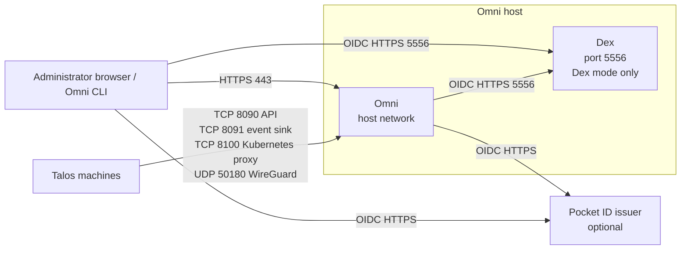

# Direct exposure

The Dex paths apply only when `omni_oidc_provider: dex`; the Pocket ID paths
apply only when `omni_oidc_provider: pocketid`. In this mode Omni uses host
networking, so the host firewall and any upstream NAT expose the required
ports directly.
