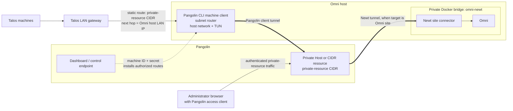

# Newt site with Pangolin private resources

The Pangolin CLI sidecar is a **consumer** of private resources, not another
Newt connector. Pangolin supplies routes for resources the machine client may
access. The LAN gateway must route the private-resource CIDR to the Omni host's
normal LAN address; it is not configured through `omni_advertised_ip`.
