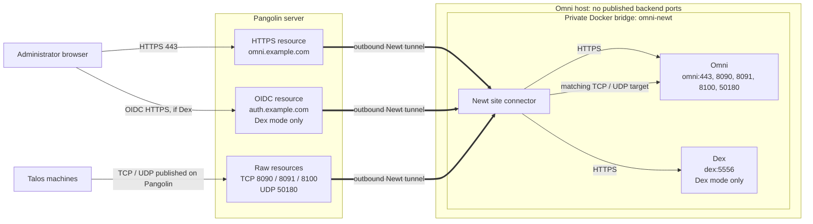

# Newt site with public resources

Newt makes an outbound connection; Omni and Dex have no published Docker ports
on the backend host. The HTTPS UI resource may use Pangolin authentication.
Raw TCP/UDP resources do not enforce Pangolin authentication and must not have
an interactive login policy in front of machine traffic.
